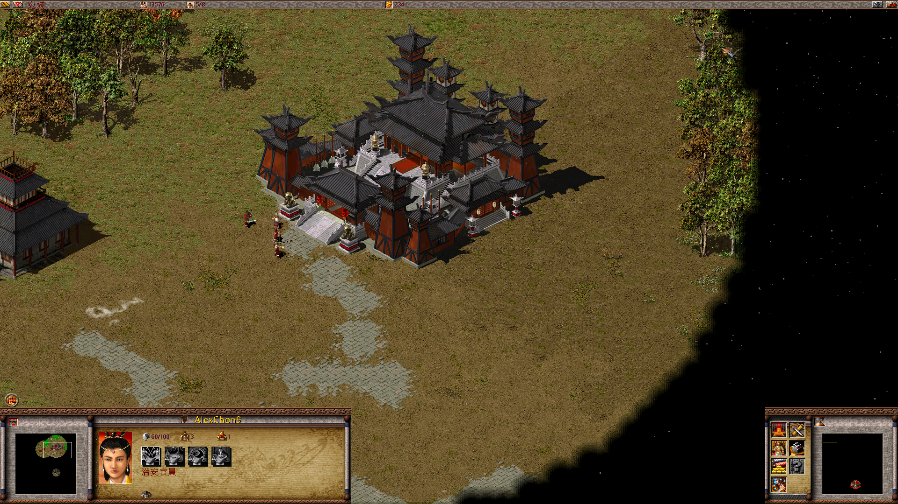
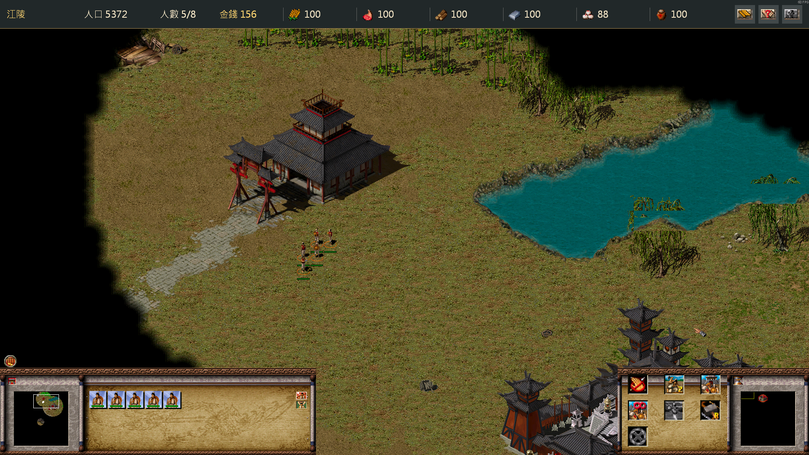
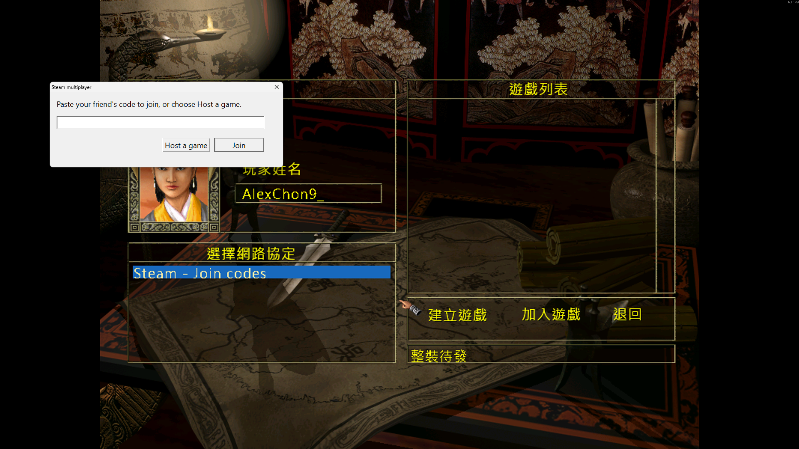

# Dragon Throne: Battle of Red Cliffs — Steam Fix

A community patch for the Windows Steam edition: native 1080p gameplay, clearer HUD and text, borderless Alt+Tab, and multiplayer through Steam join codes.

[Download the release](https://github.com/chon9/Dragon-Throne-Battle-of-Red-Cliffs-Steam-Fix/releases) · [Report a bug](https://github.com/chon9/Dragon-Throne-Battle-of-Red-Cliffs-Steam-Fix/issues) · [Support on Ko-fi](https://ko-fi.com/chon9workshop)

**Requires your own Steam copy of the game.** This repository contains patch code, not the game's source code or a standalone game. It is an unofficial community project and is not affiliated with the game's developers, publisher, or Valve.

## Features

- Native **1920 × 1080** mission rendering with separated bottom panels and working minimaps, menu entries and tooltips.
- A larger resource bar displaying the viewed/selected owned city's stocks, plus population and player gold.
- Larger right-side command buttons inside the original panel artwork; corrected placement and selection redraws.
- Fixes for duplicated buildings near units and the command-panel redraw freeze after rebuilding the button list (v0.3.2), including the remaining「任命」appointment case (v0.3.3).
- Larger, antialiased text. Public releases use **Dragon UI Bitmap**, derived from OFL-licensed Noto Sans CJK TC. The top bar uses the locally installed Windows font at runtime.
- **cnc-ddraw borderless mode** with a 60 FPS presentation limit and easier Alt+Tab.
- **Steam join-code multiplayer** without VPN software, IPX drivers or manual router forwarding.
- English / Traditional Chinese language selector, file verification, backups and rollback.

## Screenshots



*Existing screenshot from the earlier 1080p build. The public release adds the larger resource bar and command panel described above; bundled font shapes also differ.*



*Modern HUD development screenshot supplied during testing. Taken before the final bottom-right header-spacing correction; that correction was subsequently confirmed by the tester. These are gameplay captures, not mockups.*



*Steam multiplayer provider and join-code dialog. Both players need Steam online.*

## Install

1. Close the game. If you installed an earlier full-fix pack, run its **Restore.cmd** first.
2. Download **DragonFullFix-0.3.3-1080p-public-beta.zip** from [Releases](https://github.com/chon9/Dragon-Throne-Battle-of-Red-Cliffs-Steam-Fix/releases). GitHub's automatic **Source code** archives are for developers, not installation.
3. In Steam, choose **Manage → Browse local files**. Extract the ZIP so the folder layout is:

   ```text
   Dragon Throne - Battle of Red Cliffs/
     dragonthrone.exe
     DragonFullFix/
       Install.cmd
       Restore.cmd
       Language.cmd
   ```

4. Run **DragonFullFix/Install.cmd** and wait for the success message. Do not copy files out of `payload` manually.
5. Optionally run **Language.cmd** to choose English or Traditional Chinese.
6. Launch through **Steam**. Select the game's **1024 × 768** setting: this legacy option now selects **1920 × 1080 during missions**. The main menu retains its legacy layout.

The installer supports one exact original Steam executable, SHA-256:

```text
5f31d5ac6080a54649580ef6ce30cdb748e72919a54475a0342b8c3f8bf58444
```

Modified or different executable/font files are rejected before installation. Restore other HD/native/network mods using their own installers first. If Steam updates the game, wait for a compatible patch rather than bypassing hash checks. Allow about 250 MB for staging and backups. Players do not need Python or a compiler.

### Updating and uninstalling

Close the game and run **Restore.cmd**, then install the new pack. This also applies when updating from v0.3.2. The new restore script can read an unmodified older full-pack installation record if you extracted over the old package folder. Keep `modernization/history`: it holds your original files.

Restore preserves saved games and your language choice. It stops if another mod changed an installed file. Use option 3 in **Language.cmd** to restore the previous language separately.

### Language

Each player chooses their language independently. The game already supplies the translated resources; this patch does not add translated voices. The selector needs administrator access only for the game's legacy 32-bit registry language value. Installation itself does not force a language or change Steam's client language. If elevation is declined, use Steam's game language setting instead. Long English text still needs broader visual testing.

## Play with a friend

Both players need their own copy and online Steam accounts. Using the same release is recommended.

**Host:** Multiplayer → **Steam - Join codes** → **Host a game**, then create a game in the normal screen. Share the displayed code privately, click Continue, and remain in the lobby.

**Friend:** Choose the same provider, paste the code, click Join, then select the session in the game's list. Use the code, not the legacy IP address field. Do not use the old session password field; anyone who has the code can attempt to join.

Steam can provide relay routing without router setup. Steam online is also required on the same LAN. Offline LAN, host migration and automatic reconnect are not implemented.

## Status and known limits

| Area | Status |
| --- | --- |
| Windows 11 / Steam / 1080p | Tested locally |
| HUD, menus, minimaps and tooltips | Iteratively tested; final command-panel layout confirmed by user |
| Building duplication / command-panel freeze | Corrections confirmed in local gameplay; regression tests added |
| Two-PC multiplayer | User and friend confirmed play on the preceding adapter; protocol unchanged |
| Public Noto-derived fonts | Build and raster tests; broader in-game validation pending |
| Command delay | Reported for move/build/train; diagnostics added, **not claimed fixed** |
| Native 4K / other aspect ratios | Not validated; this release is a 1080p profile |
| 60 FPS | Presentation limit, not a guarantee of 60 simulation updates or minimum performance |

The release remains **beta** because broader public-font validation and other coverage gaps remain. v0.3.3 includes the appointment freeze correction in addition to the v0.3.2 stability fixes.

For multiplayer delay, play normally for at least a minute with both players connected, then attach relevant `DTNet.log` excerpts to an issue. The adapter records polling, queue and connection timing every ten seconds; it does not log chat, join codes or command payloads. Review logs before posting. Disconnect recovery and long, high-population matches need more testing.

## Development

See [BUILDING.md](BUILDING.md) for dependencies, source layout, local baseline preparation and tests. Proprietary Steamworks SDK headers/import libraries and original game files are deliberately excluded from Git. Fetch/build dependencies locally; the release ZIP contains only the permitted Steam runtime, patch payloads, custom adapter and renderer.

[CONTRIBUTING.md](CONTRIBUTING.md) describes useful bug reports and patch contributions. A configurable mod API is a future goal, not an implemented feature.

## License and credits

Original project code is [MIT licensed](LICENSE), copyright 2026 chon9. This does **not** relicense the game, its artwork, screenshots, fonts or third-party dependencies. Read [THIRD_PARTY_NOTICES.md](THIRD_PARTY_NOTICES.md) for the exact boundaries, Wine header attribution, Noto's OFL, cnc-ddraw's MIT notice and Valve's runtime terms.

Thanks to [cnc-ddraw](https://github.com/FunkyFr3sh/cnc-ddraw), [Noto CJK](https://github.com/notofonts/noto-cjk), [Wine](https://gitlab.winehq.org/wine/wine), and the community's research and testing. The [existing HD mod](https://github.com/game-patchs/FateOfTheDragonExpansionEx-HD) and [RedirectPlay](https://github.com/Sh0wdown/RedirectPlay) were research references; their mod DLLs are not bundled here.

## Support

If this project helps you enjoy the game again, you can [support chon9's workshop on Ko-fi](https://ko-fi.com/chon9workshop). Donations are optional; the patch and source remain freely available.
